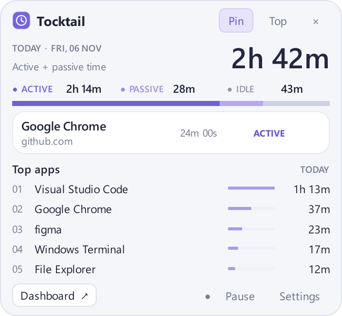

# Tocktail

[English](README.md) · [設計書（Single Source of Truth）](docs/DESIGN.md)

Python 3.12以上で開発する、Windows 11向けのローカルPC作業時間トラッカーです。
現在は **Phase 1～4** の機能を実装しています。ウィンドウ監視・SQLite・トレイUI・Chrome/Edge連携に加え、Windowsのロック／電源通知、履歴ダッシュボード、自動起動、ポータブル配布を追加しました。
ブラウザ詳細の記録には [拡張／Hostの導入](docs/BROWSER_SETUP.ja.md) と、前面ウィンドウの検証が必要です。
実際のスリープ・ログオン・クリーンPC・実時間24時間連続運転のリリース検証は未実施です。

## Windows + uv + VS Codeでの開発

[uv](https://docs.astral.sh/uv/)を導入し、このフォルダーをVS Codeで開いてPowerShellから実行します。

```powershell
uv python install 3.12
uv sync --dev
uv run tocktail-desktop
```

管理者権限は不要です。トレイアイコンをクリックするとポップアップを開閉できます。
アイコンが見えない場合は、Windowsのトレイの隠れたアイコンも確認してください。
右クリックメニューから一時停止・再開、設定、終了ができます。ポップアップを閉じても計測は続きます。
終了する場合は **Quit Tocktail** を選ぶと、最後に観測した時点まで保存して終了します。
既定のDBは `%LOCALAPPDATA%\Tocktail\tocktail.sqlite3` です。再起動しても履歴が残ります。
DBや個人の活動記録をリポジトリにコミットしないでください。

```powershell
# 起動時にポップアップを開く／既存コマンドからGUIを起動する
uv run tocktail-desktop --show
uv run tocktail --gui

# Phase 1のCLIも利用可能（Ctrl+Cで終了）
uv run tocktail

# 別DBに30秒だけ記録。アイドル閾値を10秒にする
uv run tocktail --db .\local-test.sqlite3 --idle-seconds 10 --duration 30

# 除外するプロセス名を指定（繰り返し指定可能）
uv run tocktail --exclude-app passwordmanager.exe

# ウィンドウタイトル保存を明示的に有効化（機微情報を含む可能性あり）
uv run tocktail --save-titles

uv run python -m tocktail --help
```

アイドル閾値の初期値は300秒で、変更値はDBの `settings` に保存します。
デスクトップ版は除外アプリ・サイト、タイトル保存、ピン留め、最前面表示も保存し、再起動なしで反映します。
CLIの除外指定・タイトル保存指定は起動ごとに指定します。
Tocktail自身のPIDは、ポップアップ・設定画面を含めて自動除外します。
CLIをホストするWindows TerminalやVS Codeは別プロセスなので通常のアプリとして計上します。
ブラウザAPIが返すURLは送信前にoriginへ縮約し、URL全文は送信・保存しません。
キー入力内容、入力文字列、マウス座標、個々の入力イベントは取得しません。
タイトル保存は既定で無効です。計測対象のプロセス名と実行ファイルパスは保存します。

VS Code用に仮想環境のPython選択、pytest検出、モジュール起動の設定を同梱しています。
利用する場合はMicrosoftのPython / Python Debugger拡張を導入してください。

## デスクトップUI



幅336px・高さ310pxのコンパクトなポップアップに、今日の合計使用時間（ACTIVE＋PASSIVE）、状態別内訳、現在のアプリと継続時間、使用時間上位5アプリを表示します。
集計はローカル日付の境界で区切り、進行中の観測時間とチェックポイントを二重加算しません。
Tocktailの画面自体は除外されるため、操作中は **Excluded from tracking** と表示される場合があります。

- **Pin**：外部クリックでもポップアップを閉じません。ヘッダーをドラッグして移動できます。
- **Top**：他のウィンドウより手前に表示します。ピン留めとは独立した設定です。
- **Pause / Resume**：計測を一時停止・再開します。停止中は使用時間に含めず、アプリ再起動時は計測を再開します。
- **Settings**：アイドル閾値（1～86400秒）、除外する実行ファイル名・ドメイン、今後のタイトル保存、Pin、Topを設定します。DB保存の確認後に設定画面を閉じます。
- **Dashboard**：1・7・30日分の日別グラフ、アプリ別／サイト別集計、最新500セッションを表示します。終了日を選べ、表示中は5秒ごとに更新します。
- **Start with Windows**：トレイメニューからユーザー単位の自動起動を設定します。既定では無効です。

タイトル保存・除外設定の変更は今後の記録に適用し、過去の履歴は削除しません。
ピン留め中でも×やEscapeで明示的に閉じられます。保存済みのPinが有効な場合は起動時に再表示します。
PASSIVEは、フォアグラウンドタブのHTML audio/videoで、鮮度と対応付けを確認できた再生情報がある場合だけです。
拡張や確実な対応付けがない場合はアプリ単位とし、音が出ているだけではPASSIVEを推測しません。
CLIとデスクトップ版は同じDBへの書き込みロックを共有するため、同じDBで同時起動しないでください。

## ブラウザ連携

共通の `browser-extension` フォルダーをChrome/Edgeに読み込み、実際の拡張IDでNative Hostのファイルを作成・確認したうえで、明示的に登録します。
具体的なコマンドとユーザー単位の変更内容は [日本語の導入手順](docs/BROWSER_SETUP.ja.md)・[English setup](docs/BROWSER_SETUP.md) に記載しています。

- 複数ウィンドウに対応しています。フォーカス・ネイティブプロセスが一致し、前面タブのタイトルがWindows側で一意に一致する場合にサイト情報を割り当てます。
  同名・取得不能なタイトル、不一致、遅延、切断時はアプリ単位へフォールバックします。
- シークレット／InPrivateや内部ページの詳細は記録しません。拡張から送るURLはoriginまでとし、パス・検索語・認証情報は送りません。
  DBにはドメインを保存し、`contents.url` はNULLです。
- **Excluded sites** は検証済みのドメインとサブドメインを除外します。未検証時はブラウザタイトルを残さずアプリ時間だけを計測します。
  タイトル保存・サイト除外の設定は、今後のデスクトップ記録へ適用します。
- 従来のCLIはアプリ単位です。ブラウザ連携にはデスクトップ版を利用してください。

パレットでは、検証済みの現在のサイトのドメインをブラウザ名の下に表示します。特定不能・除外・一時停止時はサイト表示を消します。継続時間はアプリの連続利用時間で、サイズは336 × 310pxのままです。

```powershell
# 導入後、今日の保存済みサイト使用時間を読み取り専用で確認
uv run tocktail-sites
```

今回の開発セッションでは、実際のChrome・Edgeへの拡張導入と接続試験は未実施です。
モックによるPython/JS検証と実Windows Pipeの結合試験の範囲は下記と実装メモに記載しています。
導入手順に従い、使用するブラウザ／プロファイルで確認してください。

## テスト

```powershell
uv run pytest -q
uv run pytest -q --run-windows
node --test browser-extension/tests/*.test.mjs
```

通常のテストは疑似観測、一時DB、オフスクリーンのQtウィジェットで動作します。
`--run-windows` はフォアグラウンド・入力状態取得、WinEventフック、別プロセスで実UIを短時間表示して正常終了する試験を追加します。
実際のNamed Pipe通信、カーネルDACL、フレーム受信からSQLiteまでの結合試験も含みます。
対話可能なWindowsデスクトップで実行してください。core/storageのテストは他OSでも実行できます。
JSはChrome API／DOMのモックを使い、実Pipeの結合試験でもブラウザ／ウィンドウの識別情報は模擬します。
実プロファイルに拡張を導入する試験ではありません。NodeはJSテストにだけ必要です。

テストの一時ファイルとpytestキャッシュは、実行ごとに新しい `.pytest-runs/run-<ランダム値>/` へ保存します。
Codexのサンドボックスと通常ユーザー間でWindowsのアクセス権限が衝突する問題を防ぎます。
このフォルダーはGit管理対象外で、調査用に保持します。明示的な `--basetemp` と `-o cache_dir=...` の指定は優先します。
`--last-failed` など実行間で履歴を共有する機能を使う場合は、書き込み可能な固定キャッシュ先を指定してください。

Windows / Python 3.12.14 / PySide6 Essentials 6.12.0で、通常実行は **187件成功・9件スキップ**、Windows実動試験込みで **196件成功** を確認しました。
Node 24.17.0では **JSテスト12件成功** です。環境と制約は [Phase 3実装メモ](docs/PHASE3.md) に記載しています。

監視を動かさずに、サンプルデータによる画面プレビューも生成できます。

```powershell
uv run python scripts/preview_ui.py
uv run python scripts/preview_ui.py --settings --output .smoke/phase2-settings.png
```

## 構成と計測方針

| モジュール | 役割 | 依存 |
| --- | --- | --- |
| `desktop/src/tocktail/monitors` | HWND/PID/実行パス/最終入力経過の取得、WinEvent監視 | 標準ライブラリctypes、Windows API |
| `desktop/src/tocktail/core` | 観測モデル、状態判定、セッション管理、期間集計 | Python標準ライブラリのみ |
| `desktop/src/tocktail/storage` | WAL SQLite、マイグレーション、復旧、単一書込ロック | 標準sqlite3、OSファイルロック |
| `desktop/src/tocktail/config` | ローカル保存先・設定値の検証 | Python標準ライブラリのみ |
| `desktop/src/tocktail/runtime` | 計測処理の統合、除外、設定反映、表示データ | core/storage/config、標準ライブラリ |
| `desktop/src/tocktail/ui` | トレイ、ポップアップ、設定、ワーカーとSignal/Slot | PySide6 Essentials |
| `desktop/src/tocktail/browser` | 検証、HWNDの観測、相関処理、Pipe、Host、登録 | Python標準ライブラリ・ctypes |
| `browser-extension` | 共通MV3 worker、メディア検出、接続ページ | Chromium拡張API。Nodeはテストのみ |
| `desktop/src/tocktail/cli.py` | 監視・保存ループ、設定、除外、デバッグ表示 | 上記モジュール |

フォアグラウンド・タイトル変更の主な検出手段は `SetWinEventHook` です。
コールバックはサイズ制限付きキューに通知するだけにし、別の処理側で最新のWindows状態を取得して計測・保存します。
フックスレッドには [Win32 APIが要求するメッセージループ](https://learn.microsoft.com/en-us/windows/win32/api/winuser/nf-winuser-setwineventhook)を設けています。
1秒間隔のポーリングも併用します。取得不能・アクセス不能・取得途中で切り替わったウィンドウはUNTRACKEDにします。

セッションは半開区間 `[start, end)` です。アプリ・ウィンドウ・コンテンツ・状態の変更で分割し、イベントとは別テーブルに保存します。
継続中は5秒ごとにチェックポイントを更新します。クラッシュで最大約5秒の未保存進捗が失われる可能性があります。
起動時は最後の保存時点で未終了セッションを閉じ、終了理由を `CRASH_RECOVERY` とします。
再起動時刻まで使用時間を補完しません。同じDBへの二重起動は復旧前のファイルロックで防ぎ、DB制約でも負の時間・時間重複・複数の進行中セッションを拒否します。
除外期間は取得不能期間と別に識別でき、除外アプリの個別情報は保存しません。

記録の位置はUTC Unixミリ秒、経過時間はUTC基準点＋単調時計で管理します。
時計変更を記録し、負の時間や重複を防ぎます。時計変更後は計測上の時刻と実際の壁時計が一時的にずれる場合があります。
再起動時も直前の保存終了時刻より前には戻しません。集計は呼出側が渡すUTC期間との重なりで行い、日付境界で分割できます。
使用時間への加算対象はACTIVEとPASSIVEのみです。

5秒を超える観測の空白はUNTRACKEDとし、前のアプリは最後に観測した時点で終了します。
長時間のスリープや処理停止を使用時間へ加算しないための保守的な処理です。
通常の状態変化は観測時点で区切るので、境界にはポーリングに由来する約1秒の不確実性があります。
coreは将来のアダプター用に一時停止・ロック・スリープ・検証済みメディア状態を受け取れます。
実監視はWindowsのロック／切断・電源通知を受け取り、順序付き観測として処理します。既知の停止区間はLOCKED／SUSPENDEDとして扱います。デスクトップ版ではユーザー操作によるPAUSEDも扱います。
検証済みのメディア再生情報なしでPASSIVEを推測しません。

DBにはセッション変更とイベントを同一トランザクションで保存します。
busy/lockedのみ最大3回まで再試行し、それ以外や再試行失敗時は計測を停止し、エラーを表示します。
無制限のメモリ蓄積は行わず、次回起動で最終コミット時点から復旧します。

## 今回の範囲と設計上の判断

詳細は [Phase 1](docs/PHASE1.md)・[Phase 2](docs/PHASE2.md)・[Phase 3](docs/PHASE3.md)・[Phase 4](docs/PHASE4.md) の実装メモを参照してください。

- 実行パスはctypesで取得するため、psutil/pywin32は追加しません。実行時の直接依存はPySide6 Essentialsのみです。
  QtCore/QtGui/QtWidgetsを利用し、未使用のWebEngineや追加モジュールは導入しません。pytestは開発依存、hatchlingはビルド用です。
- Phase 1の誤計上を防ぐため、クラッシュ復旧と観測空白の除外を先行実装しました。
  Windows通知と配布機能は実装済みです。実機の電源操作と実時間24時間連続運転は未検証で、加速シミュレーションとは区別します。
- browser IDとHWNDが同じとは仮定せず、複数ウィンドウではプロセス・フォーカスに加えてタイトルの一意性を検証し、不確実ならフォールバックします。
  プライバシーのため完全URL・パス保存は省略しています。実ブラウザへの導入・検証は手動の設定手順が必要です。
  配布版へのHost移行は配布手順に記載しています。


## 配布版・自動起動

署名なしポータブルZIPを展開して利用できます。配布版の利用先へのPython・uv導入は不要です。
[導入・更新・削除手順](docs/DISTRIBUTION.ja.md) と [English](docs/DISTRIBUTION.md) を用意しています。
ビルドだけでは、自動起動やブラウザの登録設定は変更しません。

```powershell
# 起動中のexeのロックを避けるため、Tocktailを終了し、拡張も一度無効化します。
uv sync --dev --group build
uv run --group build python scripts/build_windows.py
# 開発版の自動起動設定（トレイからも操作できます）
uv run tocktail-startup status
uv run tocktail-startup enable
uv run tocktail-startup disable
```

成果物は `dist/Tocktail-Windows-x64.zip`、起動先は `dist/Tocktail/Tocktail.exe` です。
[ダッシュボードのプレビュー](docs/assets/phase4-dashboard.png) も確認できます。

新しいテスト用DBを指定して、24時間分の加速シミュレーションを実行できます。

```powershell
uv run python scripts/soak.py --db .smoke/soak-new.sqlite3 --hours 24
```

数秒で24時間分の復旧・時間整合性を検証します。実時間24時間の運転や実機スリープ試験の代わりではありません。
実時間のCLI試験には、別DBで `uv run tocktail --db .smoke/real-soak.sqlite3 --duration 86400` を利用できます（アプリ単位の計測）。


## ライセンスと公開状況

Tocktail独自のコードは [MIT License](LICENSE) で公開します。
著作権表示は `Copyright 2026 icchi5160` です。
依存ライブラリは元のライセンスを維持します。[サードパーティの扱い](THIRD_PARTY_NOTICES.md) を参照してください。

現在は開発中のベータ版です。ソース公開と配布exeの公開判定は分けています。
ローカルのZIPは試験用で、GitHub Releasesへ添付する前に、同梱物のライセンス表示・対応ソース・差し替え方法を確認する必要があります。
実機スリープ・ログオン・別PC・実時間24時間運転も未検証です。[公開チェックリスト](docs/PUBLISHING.md) に記載しています。
