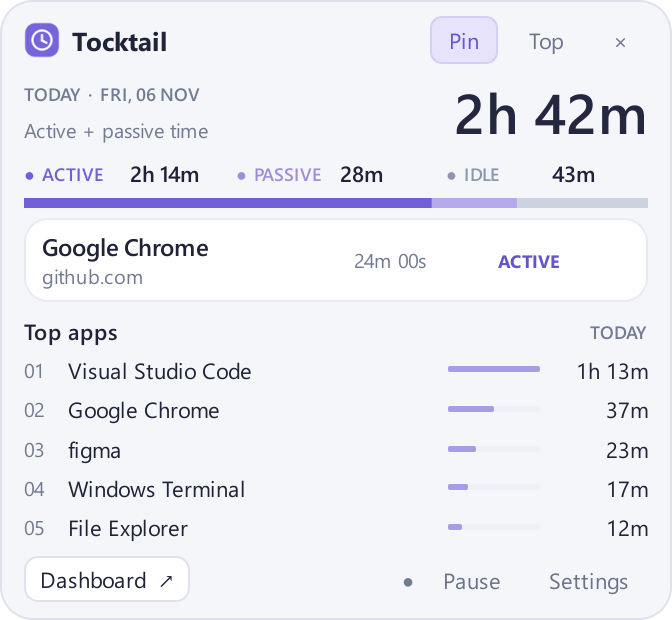

# Tocktail

[日本語](README.ja.md) · [Design (source of truth)](docs/DESIGN.md)

A privacy-first Windows 11 PC activity tracker built with Python 3.12+.
**Phases 1–4** are implemented: Windows monitoring, SQLite storage, a compact PySide6 tray UI,
Chrome/Edge integration, native lock/power notifications, history dashboard, opt-in Windows startup
and a portable Windows build. Physical sleep/logon, clean-PC and real-time 24-hour release validation remain pending.
Browser details require explicit [extension/host setup](docs/BROWSER_SETUP.md) and verified foreground-window correlation.

## Develop with uv on Windows

Install [uv](https://docs.astral.sh/uv/) and open this folder in VS Code. In PowerShell:

```powershell
uv python install 3.12
uv sync --dev
uv run tocktail-desktop
```

No administrator privileges are required. Click the tray icon to open or hide the popup. Windows may put the
icon in its tray overflow menu. Right-click for pause/resume, settings and quit. Closing the popup keeps tracking.
Use **Quit Tocktail** in the tray menu to stop and flush the last observed session.
The default database is `%LOCALAPPDATA%\Tocktail\tocktail.sqlite3`.
History remains across restarts. Do not commit databases, titles or other personal activity records.

```powershell
# Open the popup immediately; equivalent tray launch via the existing command
uv run tocktail-desktop --show
uv run tocktail --gui

# Phase 1's console monitor remains available (Ctrl+C to stop)
uv run tocktail

# Short recording with a separate database and a short idle threshold
uv run tocktail --db .\local-test.sqlite3 --idle-seconds 10 --duration 30

# Exclude process names; repeat the option for additional applications
uv run tocktail --exclude-app passwordmanager.exe

# Explicit opt-in: persist window titles (potentially sensitive)
uv run tocktail --save-titles

# Equivalent module entry point
uv run python -m tocktail --help
```

The idle threshold persists in `settings`; its initial value is 300 seconds. Desktop settings also persist
app/site exclusions, title opt-in, pinning and always-on-top preferences and apply without restarting.
CLI exclusions and title opt-in remain invocation options and must be supplied on each console run.
Tocktail's own PID is excluded automatically, including its popup and settings windows.
Windows Terminal/VS Code are separate applications and remain tracked when hosting this CLI.
Browser API URLs are reduced to origins before transfer; full URLs are never transmitted or stored.
Keystrokes, typed text, mouse coordinates and individual input events are never collected.
Window titles are disabled by default. Process names and executable paths are stored for tracked applications.

VS Code settings select `.venv\Scripts\python.exe`, enable pytest discovery and provide a module launch
configuration. Install Microsoft's Python/Python Debugger extensions to use these editor features.

## Desktop UI



The compact 336 × 310px popup shows today's ACTIVE + PASSIVE usage, the ACTIVE/PASSIVE/IDLE breakdown, the current
application and its continuous foreground duration, and the top five applications by usage. Counts use
local calendar-day boundaries and include live observed progress without double-counting checkpoints.
Opening Tocktail itself creates an excluded interval, so the popup may show **Excluded from tracking**.

- **Pin** keeps the popup open when clicking elsewhere. Drag the header to move it.
- **Top** independently keeps the popup above other windows. Pinning alone does not enable this.
- **Pause/Resume** changes tracking state; paused time is excluded. Pause resets on application restart.
- **Settings** controls the idle threshold (1–86400 seconds), excluded executable names/domains, future title
  recording, pinning and always-on-top. Saving waits for confirmation from the database worker.
- **Dashboard** opens 1/7/30-day history with a daily chart, app/site totals and the latest 500 sessions.
  Choose an end date; the visible dashboard refreshes every five seconds.
- **Start with Windows** in the tray menu opts into per-user logon startup. It is off by default.

Title/exclusion changes affect future observations; they do not erase historical records. The popup can
be hidden explicitly with × or Escape even when pinned. A saved pinned popup reopens on startup.
PASSIVE requires fresh, verified HTML audio/video playback in the foreground tab. Without the browser
companion or a reliable correlation it stays application-only and cannot infer PASSIVE from sound alone.
The CLI and desktop share a single-writer lock; run only one of them against a given database.

## Browser integration

Load the common `browser-extension` directory in Chrome/Edge, obtain the real extension IDs, then prepare,
review and explicitly register the Native Messaging Host. See [English setup](docs/BROWSER_SETUP.md)
or [日本語の導入手順](docs/BROWSER_SETUP.ja.md) for the complete commands and exact per-user changes.

- Multiple browser windows are supported when focus and native process agree and the active page title
  uniquely identifies the native foreground window. Duplicate/unknown titles, stale data and disconnects
  fall back to app totals.
- Private browsing and internal pages have no site details. The extension sends origins without paths,
  queries, credentials or fragments; the database records domains and keeps `contents.url` NULL.
- **Excluded sites** applies to verified domains and their subdomains. Unverified intervals retain generic
  app time with browser titles suppressed. Title/site-exclusion settings apply to future desktop records.
- The original console monitor remains application-only; use the desktop app for the browser bridge.

The popup shows the verified current site domain beneath the browser name. Unavailable, excluded or paused site details are hidden; the duration remains the continuous foreground app duration. The popup stays 336 × 310px.

```powershell
# Read today's saved site usage after setup (ACTIVE + PASSIVE, no DB writes)
uv run tocktail-sites
```

The actual Chrome/Edge extension installation and live browser connection have not been tested in this
development session. Python/JS mocks and real Windows pipe integration tests are described below;
validate your browser/profile using the setup guide before relying on site attribution.

## Tests

```powershell
uv run pytest -q
uv run pytest -q --run-windows
node --test browser-extension/tests/*.test.mjs
```

The default suite uses synthetic observations, temporary SQLite databases and offscreen Qt widgets.
The optional Windows tests read foreground/input state, exercise a real WinEvent hook and briefly open
the real tray/popup/settings UI in a subprocess, then verify clean shutdown and database integrity.
They also verify real Named Pipe communication, kernel DACL and a framing-to-SQLite integration.
They require an interactive Windows desktop. Core/storage tests also run on other platforms.
JS tests use mocked Chrome APIs/DOM state. The native transport integration simulates browser/window
identity; neither test suite installs the extension in a real Chrome/Edge profile. Node is needed only for JS tests.

Test temporary files and pytest cache default to a fresh `.pytest-runs/run-<random>/` directory in the
workspace for each invocation. This avoids Windows permission conflicts between Codex's sandbox and
your normal user session. These gitignored directories are retained for diagnostics. Explicit
`--basetemp` and `-o cache_dir=...` settings are respected; a persistent cache path is needed if you
want cross-run features such as `--last-failed`.

Verified on Windows with Python 3.12.14 and PySide6 Essentials 6.12.0: **187 passed, 9 skipped** by default;
**196 passed** including the native tests. Node 24.17.0: **12 JS tests passed**.
See [Phase 3 notes](docs/PHASE3.md) for environment details and limitations.

Reproducible previews use sample data and do not run the monitor:

```powershell
uv run python scripts/preview_ui.py
uv run python scripts/preview_ui.py --settings --output .smoke/phase2-settings.png
```

## Architecture and accounting

| Module | Responsibility | Dependencies |
| --- | --- | --- |
| `desktop/src/tocktail/monitors` | Foreground HWND/PID/executable and last-input age; WinEvent thread | stdlib `ctypes`, Windows APIs |
| `desktop/src/tocktail/core` | Immutable observations, state classification, sessions, interval aggregation | Python stdlib only |
| `desktop/src/tocktail/storage` | WAL SQLite, versioned migrations, atomic batches, recovery, single-writer lock | stdlib `sqlite3` and OS file locks |
| `desktop/src/tocktail/config` | Local data path and validated preferences | Python stdlib only |
| `desktop/src/tocktail/runtime` | Tracking orchestration, exclusions, settings and live snapshots | Core/storage/config, stdlib |
| `desktop/src/tocktail/ui` | Tray, popup, preferences, worker and Signal/Slot bridge | PySide6 Essentials |
| `desktop/src/tocktail/browser` | Validation, HWND evidence, correlation, local pipes, native host and setup | Python stdlib / ctypes |
| `browser-extension` | Common MV3 worker, media content script and connection page | Chromium extension APIs; Node only for tests |
| `desktop/src/tocktail/cli.py` | Worker loop, configuration, privacy filters, console output | Above modules |

`SetWinEventHook` is the primary foreground/name-change signal. Its callback only places a coalesced
notification in a bounded queue. A separate consumer reads fresh OS state, runs the core and writes the DB.
The hook thread pumps Windows messages, as required by the [Win32 API](https://learn.microsoft.com/en-us/windows/win32/api/winuser/nf-winuser-setwineventhook).
A one-second heartbeat supplements hook signals. Unavailable/inaccessible processes and uncertain foreground
samples become UNTRACKED; they are never assigned to the last known application.

Sessions are half-open `[start, end)` intervals, split on application/window/content/state changes.
Events and sessions occupy separate tables. Unchanged sessions checkpoint every five seconds; up to five seconds
of unsaved progress can be lost on a crash. Recovery closes an open session at its saved endpoint with
`CRASH_RECOVERY`, never at the restart time. A file lock is acquired before recovery to reject a second writer
using the same DB. SQLite constraints also reject negative/overlapping intervals and multiple open sessions.
Excluded intervals are marked separately from unavailable observations without storing excluded app identities.

UTC Unix milliseconds locate records. A UTC anchor plus monotonic deltas measures elapsed time within a run;
wall-clock changes are logged and do not create negative/overlapping durations. After a clock adjustment,
the timeline may temporarily differ from civil time. A restart anchors at no earlier than the last saved endpoint.
Aggregation clips intervals to caller-supplied UTC boundaries (including local-midnight boundaries).
Only ACTIVE + PASSIVE count toward total usage.

An observation gap over five seconds is marked UNTRACKED; the previous app ends at its last observation.
This conservatively avoids charging long suspend/stall periods. Immediate activity transitions are recorded
at their observation time, so polling introduces up to approximately one second of boundary uncertainty.
The real monitor receives native lock/disconnect and suspend/resume notifications on its message thread.
Ordered lifecycle observations close active sessions at the notification boundary; known inactive gaps
remain LOCKED/SUSPENDED. The desktop also supports user-initiated PAUSED and verified browser PASSIVE.

SQLite transactions contain both session changes and corresponding events. Busy/locked writes receive
three bounded attempts. Other failures stop tracking and surface an error; there is no unbounded event backlog or fabricated
activity while storage is unavailable. The next start recovers the last committed checkpoint.

## Scope and design decisions

See [Phase 1](docs/PHASE1.md), [Phase 2](docs/PHASE2.md) [Phase 3](docs/PHASE3.md) and [Phase 4](docs/PHASE4.md) notes for acceptance criteria and limitations.
`docs/DESIGN.md` remains the source of truth. The following timing/dependency decisions are deliberate:

- `ctypes` supplies process paths without `psutil`/`pywin32`. The only direct runtime dependency is
  PySide6 Essentials (QtCore/QtGui/QtWidgets); unused WebEngine/add-ons are not installed.
  pytest is a development dependency and hatchling is the build backend.
- Recovery and conservative observation-gap handling are included now to prevent incorrect Phase 1 records.
  Native notifications, dashboard, startup and portable packaging are implemented. Physical power tests
  and real-time 24-hour soak validation remain pending; accelerated simulation is a separate check.
- Browser ID/HWND equality is never assumed. Multi-window correlation requires a unique native title plus verified focus/process;
  ambiguous windows fall back to application tracking; full URL/path storage is omitted for privacy. Real browser installation/validation is
  a manual setup step. See the distribution guide for packaged-host migration.


## Windows distribution and startup

Download/build the unsigned portable ZIP and extract its entire folder. Python/uv are not required
for the packaged app. See [installation/update/uninstall](docs/DISTRIBUTION.md) or
[日本語版](docs/DISTRIBUTION.ja.md). Building does not enable startup or change browser registrations.

```powershell
# Exit Tocktail and disable its extension first (Windows locks running host launchers).
uv sync --dev --group build
uv run --group build python scripts/build_windows.py
# Source-based startup management (also available in the tray menu):
uv run tocktail-startup status
uv run tocktail-startup enable
uv run tocktail-startup disable
```

The package is `dist/Tocktail-Windows-x64.zip`; start `dist/Tocktail/Tocktail.exe`.
Dashboard preview: [phase4-dashboard.png](docs/assets/phase4-dashboard.png).

Accelerated durability simulation (use a new test DB):

```powershell
uv run python scripts/soak.py --db .smoke/soak-new.sqlite3 --hours 24
```

This simulates 24 hours in seconds and tests recovery/interval invariants. It is not a real-time or
physical Windows sleep/lock test. For a real 24-hour console soak, use a separate test DB and
`uv run tocktail --db .smoke/real-soak.sqlite3 --duration 86400` (app-only monitor).


## License and release status

Tocktail's original code is available under the [MIT License](LICENSE).
Copyright 2026 icchi5160. Dependencies retain their own licenses;
see [third-party software](THIRD_PARTY_NOTICES.md).

This is a development beta. Source publication is separate from binary release approval. The local
portable ZIP is a test artifact: its complete third-party redistribution notices and corresponding
source/replacement arrangements still need review before uploading it to GitHub Releases.
Physical sleep/logon, clean-PC and real-time 24-hour validation also remain pending.
See the [publication checklist](docs/PUBLISHING.md).
