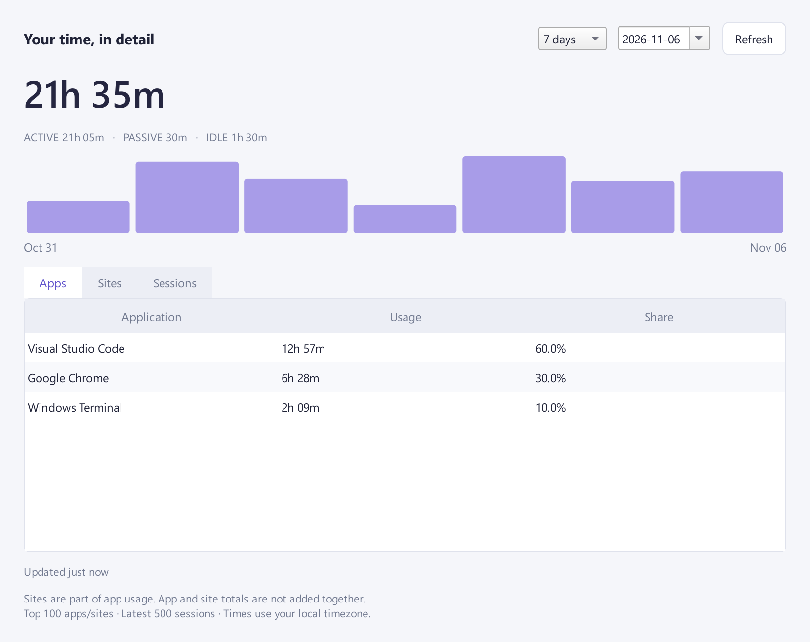

# Phase 4 — Stability and distribution

[Design](DESIGN.md) · [Install/update/uninstall](DISTRIBUTION.md) · [導入・更新・削除](DISTRIBUTION.ja.md)

The implementation adds native lifecycle monitoring, a history dashboard, opt-in startup and a portable
Windows x64 build. Physical power/logon, clean-PC and real-time 24-hour release validation remain pending;
this report does not claim that the entire MVP release checklist has passed.

## Modules and dependencies

| Responsibility | Module |
| --- | --- |
| Hidden Win32 notification window | `monitors/lifecycle.py` |
| Ordered observation queue and WinEvent pump | `monitors/windows.py` |
| Inactive interval accounting and events | `core/engine.py` |
| Immutable history values | `core/history.py` |
| Bounded period reports and migration 3 | `storage/sqlite.py` |
| Period selection, charts, app/site/session tables | `ui/dashboard.py` |
| Worker-owned report queries and queued signals | `ui/worker.py`, `ui/controller.py` |
| Explicit per-user Windows startup | `config/startup.py` |
| Packaged console command routing | `tools.py` |
| Three executable shared onedir build | `distribution/Tocktail.spec`, `scripts/build_windows.py` |
| Accelerated durability simulation | `scripts/soak.py` |

There are no new runtime dependencies. PyInstaller is in the optional `build` dependency group only;
the existing PySide6 Essentials supplies the dashboard widgets and custom-painted graph. Core remains
free of Qt, Win32 and storage imports. No browser permissions or message protocol changed.

## Native lock and power handling

A hidden top-level Win32 window is created/destroyed on the existing hook/message-pump thread. It
registers for this-session WTS events and suspend/resume notifications. Startup queries `WTSSessionInfoEx`
to avoid assuming that an already-locked/disconnected session is active. Only state/flags are read;
temporary WTS name fields are not accessed or persisted.

- Lock and console/remote disconnect set LOCKED. Connect/unlock re-query the real session flags.
- Suspend sets SUSPENDED. Automatic/interactive/critical resume clears suspend state.
- The callback enqueues timestamped state-only observations in a bounded queue of 64 and wakes the worker.
  It does not write SQLite or manipulate widgets. Registration failure or queue overflow stops tracking.
- The worker/CLI drains transitions and samples fresh foreground state under the same monitor lock. This
  prevents a later ordinary sample from overtaking a queued suspend/lock boundary. Resumption takes a
  fresh OS/browser observation; it does not reuse a remembered active app across sleep.
- Core logs SESSION_LOCKED/UNLOCKED and SYSTEM_SUSPENDED/RESUMED. Long known inactive gaps remain
  LOCKED/SUSPENDED; other observation gaps remain UNTRACKED. Neither contributes to total usage.
- If the monotonic clock omits a suspend interval, forward UTC elapsed time across a known inactive
  boundary anchors the resumed timeline conservatively. Clock reversal never creates negative time.

These APIs follow Microsoft's [WTS session notification contract](https://learn.microsoft.com/en-us/windows/win32/api/wtsapi32/nf-wtsapi32-wtsregistersessionnotification),
[session flag definition](https://learn.microsoft.com/en-us/windows/win32/api/wtsapi32/ns-wtsapi32-wtsinfoex_level1_w)
and [suspend/resume registration](https://learn.microsoft.com/en-us/windows/win32/api/winuser/nf-winuser-registersuspendresumenotification).
The target is Windows 11; obsolete Windows 7 reversed lock flags are not supported.

Crash recovery still closes an open session at its last committed checkpoint and never fills the time
until restart. A new subprocess test commits a five-second checkpoint and calls `os._exit(9)` with a
later unsaved observation, verifying actual WAL durability/recovery rather than only simulated service exit.

## Dashboard

Open **Dashboard** in the compact popup or **History dashboard…** in the tray. Choose 1/7/30 days and an
end date. The report includes all activity-state totals, daily ACTIVE+PASSIVE bars, top 100 apps/sites
and latest 500 session intervals. Sites are app subdivisions, never an additional total. Tooltips expose
complete table values and daily chart values. Excluded intervals do not expose identities.

SQLite aggregates before returning data; the raw timeline is bounded. The single writer worker owns all
queries, and immutable reports cross queued Qt signals. The latest in-memory session replaces its saved
checkpoint to avoid double counting. Civil day boundaries clip midnight/DST intervals. Reports refresh
every five seconds only while visible; stale responses for a previous period are ignored. Closing the
dashboard does not stop tracking. Migration **3** adds an end-time interval index for recent-period queries;
existing records and schema columns are unchanged.



## Startup and portable build

**Start with Windows** in the tray is opt-in and stores a quoted command under the current-user Run key.
Registry state is authoritative; it is not duplicated in SQLite. The command uses `pythonw.exe` plus the
installed module in source mode, or the adjacent `Tocktail.exe` in a frozen build, with an explicit DB path.
It does not overwrite/remove a startup entry belonging to a different installation or DB. Actual user
startup is never enabled by a build or test; the registry round-trip test uses an isolated temporary key.

The portable archive contains windowed `Tocktail.exe`, console `TocktailTools.exe`, console
`tocktail-native-host.exe`, shared `_internal`, the unpacked extension and installation documentation.
The console tool dispatches sites/browser-host/startup/monitor. Frozen Host preparation pins the adjacent
Host executable, so the package does not depend on a development virtual environment. Build and sample
preparation make no registry/profile changes. Read the distribution guide before moving from a source
installation or updating a running build. Windows locks loaded Host `.exe` launchers: exit Tocktail and
disable the extension before `uv sync`/upgrades. The source installation and launchers were verified after dependency installation.

The distribution choice is a portable onedir ZIP, with installation/removal instructions, rather than a
signed installer. This implements the design's PyInstaller packaging without introducing an installer
compiler or automatic external changes. Code signing and clean-PC release acceptance are not claimed.

## Verification

Windows 11 x64, Python 3.12.14, PySide6 Essentials 6.12.0, PyInstaller 6.22.3:

```text
python -m pytest -q -W error
187 passed, 9 skipped

python -m pytest -q --run-windows -W error
196 passed

python scripts/soak.py --db <new-test-db> --hours 24
24 simulated hours; 1,468 sessions; 3 crash recoveries;
0 overlaps; 0 negative intervals; integrity=ok
```

Native tests register a real notification window and synchronously inject lock/suspend/resume messages
into it. They do not lock or suspend the user's computer. Tests also cover brief/long inactive periods,
monotonic/UTC suspend divergence, midnight clipping, live checkpoint replacement, domain/app hierarchy,
history limits, stale UI responses, worker-owned reports, quoted startup paths and isolated registry changes.

The built desktop was launched for three seconds with an independent test DB: exit 0, SQLite integrity
ok, no open sessions afterward. The packaged site report and Host preparation succeeded; preparation
points to the packaged Host and performs no installation. The dashboard was rendered at 820 × 650 logical
pixels with synthetic data and visually inspected. The compact popup remains 336 × 310.

The accelerated simulation processes one observation per simulated second and periodically reopens the
DB without normal service shutdown. It completes in seconds and is explicitly **not** a 24-hour real-time
soak. For a separate real-time app-only CLI soak, use a test DB and `--duration 86400`.

## Remaining release validation

- Physical Windows lock/unlock, sleep, hibernate and Modern Standby on actual target hardware.
- Real Windows logon startup and clean-PC extraction/launch/update/removal.
- A real 24-hour continuous run, including browser reconnection after physical sleep.
- Real Edge and packaged Native Messaging/browser playback validation. Chrome single-window recording
  was confirmed by the user in Phase 3; the new package does not imply re-verification of that path.
- Signing and a native installer, if a later release requires them.

## 日本語での要点

ロック／電源通知、履歴ダッシュボード、任意のWindows自動起動、PyInstallerのポータブル配布を実装しました。
SQLiteはマイグレーション3で集計用インデックスを追加し、過去の履歴は保持します。
Pythonテストは通常187件成功・9件スキップ、Windows実動試験込みで196件成功です。
24時間分の加速シミュレーションは1,468セッション・3回復旧・重複0・負の時間0・DB整合性okでした。
配布exeの起動・終了とDB保存も確認済みです。実際のスリープ・ログオン・クリーンPC・実時間24時間運転は未検証です。
日英の配布手順を参照してください。ビルド・テストは本番の自動起動やブラウザ登録を変更しません。
